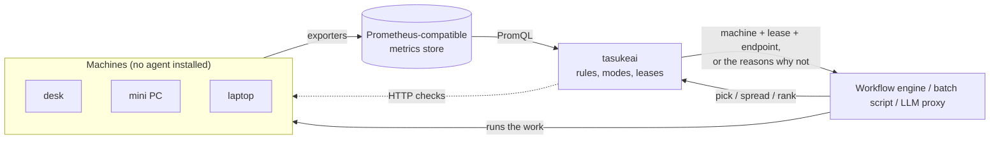

# tasukeai

*tasukeai* (助け合い) is Japanese for "helping each other".

tasukeai tells **which machine should take a piece of work now**, among machines that also have other lives: a
desktop someone plays games on, a laptop that leaves the house, a mini PC that runs hot. It reads the metrics the
machines already export (Prometheus-compatible) and applies the owners' rules ("only on AC", "only after 10 minutes
without input", "not above 80 °C"). It does not run the work; it answers, with reasons, to whatever runs it.



- **No agent, no queue, no execution.** One binary, one TOML file. Signals come from the exporters you already run,
  plus optional HTTP checks at decision time.
- **Three modes.** `exclusive` (one heavy job per machine, with a lease), `spread` (N workers over free slots),
  `rank` (usable machines in order, for short requests such as LLM chat).
- **Reasons, not just answers.** Every machine left out says why: `idle_seconds = 120 < 600 (someone is using it)`.
- **Fail closed.** A machine that stops reporting (off, asleep, away) has unknown signals, and unknown fails its rules.
- **Small.** A static binary of about 7 MiB using a few MiB of memory; runs on edge devices (x86_64, aarch64) with
  systemd, Docker or Kubernetes.

Status: early. The decision core, signal collection, leases, holds and state are built and tested; v0.x may still
change the configuration.

## Quick start

```sh
cp examples/tasukeai.toml tasukeai.toml    # describe your machines and jobs
docker compose -f docker/compose.yaml up -d
curl -s 'localhost:9660/assess?job=train'  # who can take it, and why not
curl -s -X POST 'localhost:9660/pick?job=train'
```

## Docs

| | |
|---|---|
| [Configuration](docs/configuration.md) | signals, machines, jobs, rules, how a decision is made |
| [HTTP API and CLI](docs/api.md) | calls, leases, endpoints, holds, scripts |
| [Deployment](docs/deployment.md) | binary, systemd, Docker, Kubernetes (Helm), footprint |
| [Development](docs/development.md) | building, CI, releases |
| [Security](docs/security.md) | reporting a vulnerability, the trust model, hardening |
| [Design notes](docs/design.md) | why, concepts, open questions |

## The name

*tasukeai* (助け合い) means "helping each other". *Tasuke* (助け) is "help"; *ai* (合い, from *au*, "to come
together") makes it mutual, something done together. The pun is intended: the work it was made for is AI work
(LLM chat, extraction, training) on whatever machines can lend a hand right now, and read as English the name
ends in "AI".

## License

Apache License 2.0. See [LICENSE](LICENSE) and [NOTICE](NOTICE).
