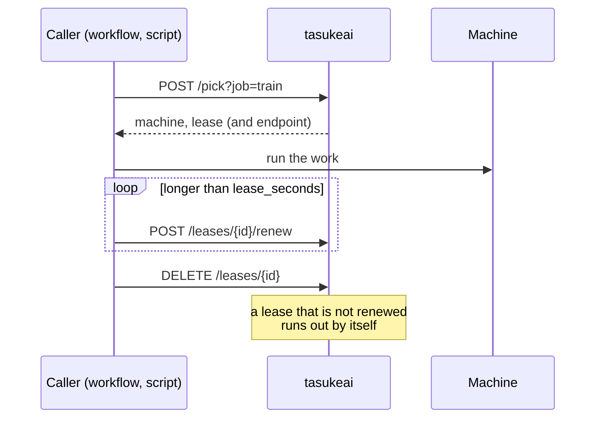

# HTTP API and CLI

`tasukeai serve` answers on port 9660 (`--listen`, default `0.0.0.0:9660`). The API has no authentication yet (#2):
keep it on a network you trust.

## HTTP

| Call | Answer |
|---|---|
| `GET /health` | `ok` |
| `GET /machines` | every machine's signals and what could not be collected |
| `GET /assess?job=<kind>` | usable machines in order, reasons for the others (no lease); takes rules of the caller like `/rank` |
| `POST /pick?job=<kind>` | `exclusive`: `{machine, lease, assessment}`; 409 with the reasons when none is free |
| `POST /spread?job=<kind>&count=N` | `spread`: up to N leases, a machine once per free slot; 409 when none |
| `GET /rank?job=<kind>[&min.<signal>=x][&max.<signal>=x]` | `rank`: `{machines, endpoints, assessment}`, no lease |
| `GET /leases` | the leases that have not run out |
| `POST /leases/<id>/renew` | extend a lease by its job's `lease_seconds` |
| `DELETE /leases/<id>` | give the machine back |
| `POST /holds` | keep a machine out by hand: `{"machine", "job"?, "minutes"?, "note"?}`; 201 with the hold |
| `GET /holds` | the holds that have not run out |
| `DELETE /holds/<id>` | end a hold |

## Leases

A lease is a short reservation after a machine is handed out, so the next decision does not hand it out again before
its metrics catch up or while the work loads its model. A lease of an `exclusive` job holds the whole machine; a
`spread` lease holds one slot of its own job. Decisions and leases are taken under one lock, so two callers never get
the same slot.



If the work finds out on start that it does not fit after all (say, free VRAM), it releases the lease and the caller
asks again; the next machine comes.

## Endpoints

A machine may name addresses of its services (`endpoints = { llm = "http://desk:11434/v1" }`) and a job the one it
uses (`endpoint = "llm"`). Each lease then carries `endpoint` (the URL), and `/rank` answers `endpoints` in the order
of `machines`, so callers need no address table of their own.

Rejected machines carry their `endpoint` too, so a caller that routes by address (an LLM proxy with a list of
servers) can tell "known but not usable now" from "not known to tasukeai".

## Rules of the caller

`/rank` and `/assess` take extra rules for one decision as query parameters, `min.<signal>=<number>` and
`max.<signal>=<number>` (e.g. `min.vram_free_gb=10` for a model that needs 10 GB). Like configured rules, a missing or
stale signal fails them; the reason ends in `(asked by the caller)`.

## Holds

A person keeps a machine out by hand: for every job or one job, until a time or until ended. Held machines are not
offered by `pick`, `spread` or `rank`; the reason reads `held by hand[ for <job>][ until <time>][: <note>]`. Leases
already given stay until they run out or are released.

## CLI

All commands take `--config <file>` (default `tasukeai.toml`). Commands that talk to a running server take
`--server` (default `http://127.0.0.1:9660`).

| Command | Does |
|---|---|
| `tasukeai check` | validate the configuration, print machines and jobs |
| `tasukeai serve [--listen ADDR]` | serve the HTTP API |
| `tasukeai signals` | the signals of every machine now (local, no server) |
| `tasukeai assess <job>` | who can take the job now and why not (local, no lease) |
| `tasukeai pick <job>` | ask the server for a machine; prints `machine lease-id` |
| `tasukeai release <lease>` | give a lease back |
| `tasukeai hold <machine> [--job J] [--minutes M] [--note N]` | keep a machine out by hand; prints the hold id |
| `tasukeai unhold <hold>` | end a hold |
| `tasukeai holds` | list the holds |
| `tasukeai health [--addr ADDR]` | exit 0 when the server answers `/health` (for container health checks) |

`pick` exits **75** when no machine is free, with the reasons on stderr, so a script can wait and retry:

```sh
out=$(tasukeai pick train --server http://tasukeai:9660) || exit $?   # 75: none free now
read -r machine lease <<<"$out"
ssh "$machine" ./train.sh
tasukeai release "$lease" --server http://tasukeai:9660
```
