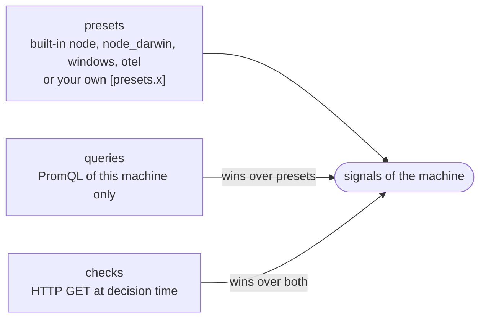
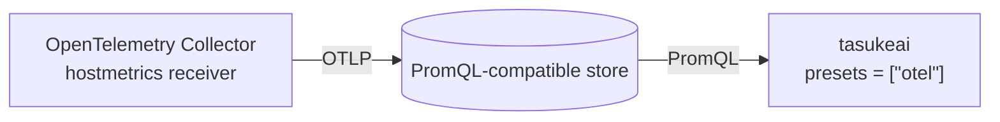
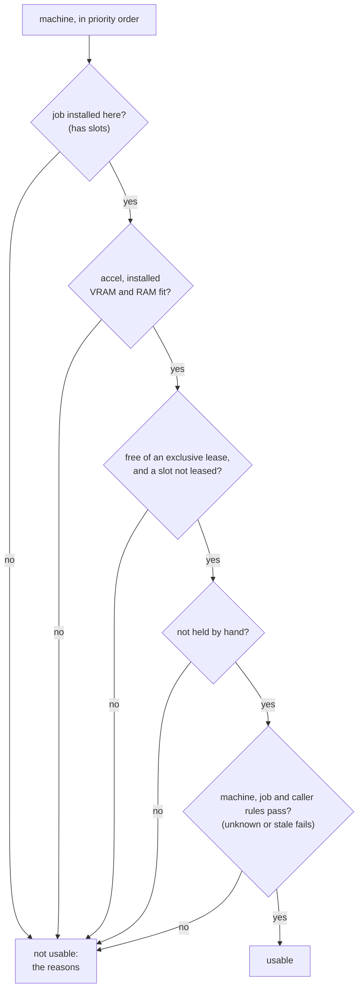

# Configuration

One TOML file describes the machines, the jobs and the rules. `tasukeai --config <file>` reads it (default
`tasukeai.toml`; the container image reads `/tasukeai.toml`). `tasukeai check` validates it and prints the machines
and jobs. A full example: [examples/tasukeai.toml](../examples/tasukeai.toml).

Keep the file in version control. It is never edited at run time; what changes at run time (leases, holds) is
[state](#state).

## Top level

| Key | Default | Meaning |
|---|---|---|
| `stale_after_seconds` | `120` | A signal older than this counts as unknown |
| `[metrics]` | | Where signals come from (below) |
| `[presets.<name>]` | | Your own signal presets, added to the built-in ones |
| `[machines.<name>]` | required | The machines that may take work |
| `[jobs.<name>]` | | The kinds of work, each with a mode |
| `[state]` | memory only | Where leases and holds are kept across restarts |
| `[ui]` | off | The admin page at `/ui` (below) |

## Metrics

| Key | Default | Meaning |
|---|---|---|
| `url` | none | Base URL of a Prometheus-compatible query API (`/api/v1/query` is added). Without it, only HTTP checks give signals |
| `timeout_ms` | `3000` | Timeout of one query |
| `cache_seconds` | `10` | How often signals are collected. `serve` collects them in the background at this interval and answers every request from the last round at once, so a slow query or a machine that does not answer (each check waits up to its timeout) never delays `/rank`, `/pick` or `/spread`. A stuck round fails safe: its signals grow older than `stale_after_seconds` and count as unknown. The one-shot commands collect when they run |

## Signals

A signal is a number about a machine now: `up`, `ram_usable_bytes`, `idle_seconds`, `gpu_temp_celsius`, ... Each
machine gets its signals from three places; later ones win for the same name.



- **presets**: named sets of PromQL. The built-in ones read standard exporter metrics (`node`: node_exporter on
  Linux, `node_darwin`: node_exporter on macOS, `windows`: windows_exporter, `otel`: OpenTelemetry Collector on
  Linux, below); see [presets.toml](../crates/tasukeai-core/src/presets.toml). Add your own for other exporters under
  `[presets.<name>]`.
- **queries**: PromQL for one machine, `queries = { idle_seconds = '...' }`.
- **checks**: `checks = [{ signal, url, timeout_ms?, json? }]`. The signal is 1 when the URL answers 2xx in time, else
  0; with `json`, it is the number at that JSON pointer in the answer.

`{instance}` in an expression becomes the machine's `instance` label (default: the machine's name).

**Unknown fails.** A query with no result, or a signal older than `stale_after_seconds`, is unknown, and an unknown
signal fails every rule on it. A machine that is off, asleep or away stops reporting and is not offered. Add a rule
on `up` to say so explicitly. If the metrics store does not answer, its signals are unknown too, so a machine with a
rule on `up` is not offered (fail closed).

### OpenTelemetry

Machines that send OpenTelemetry metrics instead of exposing Prometheus exporters work too, as long as the metrics
end up in a store tasukeai can query with PromQL. tasukeai does not receive OTLP itself.



The built-in `otel` preset reads the Collector's `hostmetrics` receiver on Linux: `up`, `ram_usable_bytes`,
`ram_total_bytes`, `cpu_busy_ratio`, `load15`. It needs:

- names in Prometheus style and resource attributes as labels: `system.cpu.time` as
  `system_cpu_time_seconds_total`, `host.name` as `host_name`. The machine's `instance` is matched against
  `host_name`.
- the optional metrics `system.memory.limit` and `system.linux.memory.available` enabled in the Collector (the
  `system.memory.usage` states overlap and do not add up to the total).
- the `system` scraper: OTLP has no `up` series, so `up` is 1 while `system.uptime` is younger than 2 minutes.

Checked with OpenTelemetry Collector Contrib 0.165.0 and VictoriaMetrics v1.156.0
(`-opentelemetry.usePrometheusNaming`): all five signals read, and a machine whose Collector stops is rejected with
`up = 0 < 1` after about 150 s. Other stores (Prometheus with its OTLP receiver, ...) may name or label the metrics
differently; check what they store and write your own preset if needed. A runnable setup is in
[examples/otel/](../examples/otel/).

## Machines

| Key | Default | Meaning |
|---|---|---|
| `priority` | required | Lower is tried first |
| `accel` | required | `cuda`, `rocm`, `metal`, `cpu`, ... |
| `vram_gb`, `ram_gb` | `0` | Installed memory (static; what is usable now is a signal) |
| `jobs` | none | Jobs installed here, with slots: `{ extract = 2, chat = 1 }` |
| `instance` | the name | The `instance` label of its metrics |
| `presets`, `queries`, `checks` | none | Its signals (above) |
| `rules` | none | Owner rules (below) |
| `endpoints` | none | Named addresses of its services: `{ llm = "http://desk:11434/v1" }` |
| `watts` | none | Power while working, measured once; for jobs ordered by energy (see "Order") |

## Jobs

| Key | Default | Meaning |
|---|---|---|
| `mode` | required | `exclusive`, `spread` or `rank` |
| `accel` | any | Accelerators the job can use: `["cuda"]` |
| `vram_gb`, `ram_gb` | `0` | Installed memory the job needs at least |
| `rules` | none | Rules of the job, on top of the machine's |
| `lease_seconds` | `600` | How long a lease lasts (renew it for longer work; a renew assesses the machine again) |
| `endpoint` | none | Which machine endpoint the job uses; leases and `rank` answers carry its URL |
| `order` | `priority` | How usable machines are ordered: `priority` or `energy` (see "Order") |
| `seconds` | none | Seconds one unit of the job takes on each machine: `{ desk = 3.0, mini = 10.2 }` |

| Mode | For | Answer |
|---|---|---|
| `exclusive` | One heavy job that occupies a machine (training) | The first usable machine, with a lease that holds the whole machine |
| `spread` | N copies of the same work in parallel (extraction workers) | Up to N leases, a machine once per free slot, in priority order |
| `rank` | Short requests one at a time (LLM chat) | The usable machines in order, no lease |

A job naming an `endpoint` that a machine with a slot for it lacks is a configuration error.

## Rules

A rule compares one signal: `{ signal, min?, max?, because?, jobs? }`. `because` is shown in the reason when it
fails; `jobs` limits a machine rule to some jobs, so long batch work stays off a machine someone is using while short
chat requests still go there:

```toml
rules = [{ signal = "up", min = 1 },
         { signal = "gpu_temp_celsius", max = 80, because = "hot" },
         { signal = "idle_seconds", min = 600, because = "someone is using it", jobs = ["extract", "train"] }]
```

Rules come from three places: the machine (owner rules), the job, and the caller for one decision (`min.<signal>` /
`max.<signal>` query parameters of `/rank` and `/assess`, see [api.md](api.md)).

## How a decision is made

For a job, every machine is checked in priority order (then by name). Every failed check becomes a reason; a machine
with no reasons is usable.



The usable machines are then put in the job's order (below), and the mode decides: `exclusive` leases the first usable machine, `spread` fills free slots up to N, `rank` returns
them all in order. Reasons read like `idle_seconds = 120 < 600 (someone is using it)`, `all 2 slot(s) leased` or
`held by hand for extract: fan noise`.

## Order

By default (`order = "priority"`) usable machines come in priority order. A long job that is not urgent can prefer the
machine that uses less energy for the same work: with `order = "energy"`, machines are ordered by
`watts` (of the machine) × `seconds` (of the job on that machine), least first. Machines without both values follow, in
priority order. A fast machine that draws much more power can take more energy for the same unit of work than a slower,
frugal one:

```toml
[machines.desk]   # a desktop GPU
priority = 1
watts = 145
[machines.mini]   # a small Apple Silicon machine
priority = 2
watts = 17

[jobs.train-small]
mode = "exclusive"
order = "energy"
seconds = { desk = 3.0, mini = 10.2 }   # mini: 17 x 10.2 = 173 J, desk: 145 x 3.0 = 435 J, so mini first
```

- Measure both once, with the same work on each machine. Without a wall meter, the accelerator's own reading is what
  there is (`nvidia-smi --query-gpu=power.draw` for an NVIDIA GPU, `powermetrics` for the CPU, GPU and ANE of Apple
  Silicon); it leaves out the rest of the machine, so say in a comment what the numbers cover.
- The unit of `seconds` is up to you (a step, a page, a request), but it must be the same for every machine of the job.
  How much faster one machine is depends on the work (a small and a large model can differ), so work of different sizes
  is better as separate jobs.
- A request can ask for the other order for one decision: `order=priority` (urgent work on a job ordered by energy) or
  `order=energy` on `/pick`, `/spread`, `/rank` and `/assess` ([api.md](api.md)). Each answer says the `order` it used,
  and each usable machine its `energy_j` when known.

## State

```toml
[state]
path = "/data/state.json"
```

Leases and holds live in memory. With `[state] path` they are also written to that JSON file after every change (to a
temporary file, then renamed) and loaded on start; what ran out meanwhile is dropped. Put the file on a disk of its
own, such as a small persistent volume.

## Admin page

```toml
[ui]
enabled = true
```

A read-only page at `/ui`: for each job the usable machines and why the others are not, every machine's signals with
their age (stale ones marked) and a small line of the last hour, the signals that could not be collected, leases and
holds; it refreshes every 5 s. The lines come from what the page has read since it was opened (kept in the browser
tab, one point per collection, the last hour only: about 1 MB for 75 signals); the server keeps no history.
Off by default, and then the routes do not exist. Its HTML, script and style are built into the binary (about 10 KB)
and served as they are; the browser reads the same JSON API as the CLI, so the page costs the server nothing between
requests. Turn it on for one node where several run. With `TASUKEAI_API_KEY` set, the page's files are served without
the key (they hold no data) and the page asks for the key, keeps it in the browser tab and sends it on its API calls.
