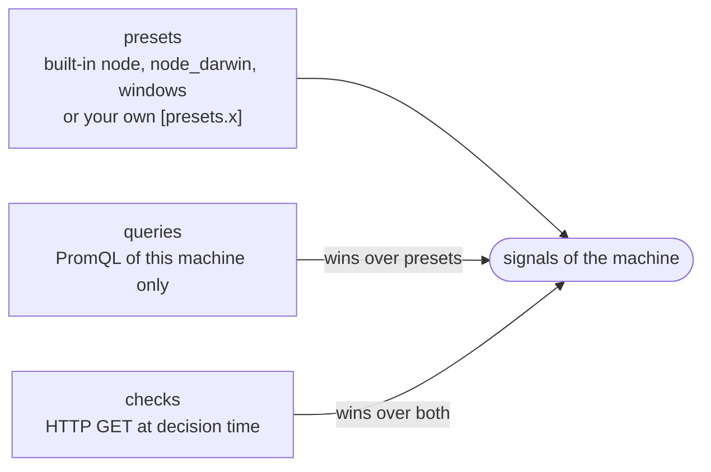
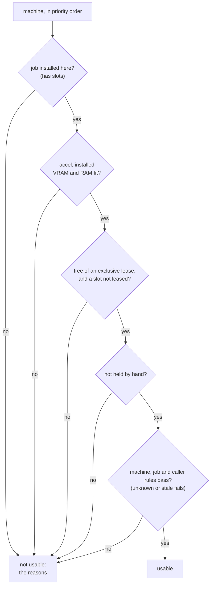

# Configuration

One TOML file describes the machines, the jobs and the rules. `tasukeai --config <file>` reads it (default
`tasukeai.toml`; the container image reads `/tasukeai.toml`). `tasukeai check` validates it and prints the machines
and jobs. A full example: [examples/tasukeai.toml](../examples/tasukeai.toml).

Keep the file in version control. It is never edited at run time; what changes at run time (leases, holds) is
[state](#state).

## Top level

| Key | Default | Meaning |
|---|---|---|
| `stale_after_seconds` | `120` | A signal older than this counts as unknown |
| `[metrics]` | | Where signals come from (below) |
| `[presets.<name>]` | | Your own signal presets, added to the built-in ones |
| `[machines.<name>]` | required | The machines that may take work |
| `[jobs.<name>]` | | The kinds of work, each with a mode |
| `[state]` | memory only | Where leases and holds are kept across restarts |

## Metrics

| Key | Default | Meaning |
|---|---|---|
| `url` | none | Base URL of a Prometheus-compatible query API (`/api/v1/query` is added). Without it, only HTTP checks give signals |
| `timeout_ms` | `3000` | Timeout of one query |
| `cache_seconds` | `10` | How often signals are collected. `serve` collects them in the background at this interval and answers every request from the last round at once, so a slow query or a machine that does not answer (each check waits up to its timeout) never delays `/rank`, `/pick` or `/spread`. A stuck round fails safe: its signals grow older than `stale_after_seconds` and count as unknown. The one-shot commands collect when they run |

## Signals

A signal is a number about a machine now: `up`, `ram_usable_bytes`, `idle_seconds`, `gpu_temp_celsius`, ... Each
machine gets its signals from three places; later ones win for the same name.



- **presets**: named sets of PromQL. The built-in ones read standard exporter metrics (`node`: node_exporter on
  Linux, `node_darwin`: node_exporter on macOS, `windows`: windows_exporter); see
  [presets.toml](../crates/tasukeai-core/src/presets.toml). Add your own for other exporters under `[presets.<name>]`.
- **queries**: PromQL for one machine, `queries = { idle_seconds = '...' }`.
- **checks**: `checks = [{ signal, url, timeout_ms?, json? }]`. The signal is 1 when the URL answers 2xx in time, else
  0; with `json`, it is the number at that JSON pointer in the answer.

`{instance}` in an expression becomes the machine's `instance` label (default: the machine's name).

**Unknown fails.** A query with no result, or a signal older than `stale_after_seconds`, is unknown, and an unknown
signal fails every rule on it. A machine that is off, asleep or away stops reporting and is not offered. Add a rule
on `up` to say so explicitly. If the metrics store does not answer, its signals are unknown too, so a machine with a
rule on `up` is not offered (fail closed).

## Machines

| Key | Default | Meaning |
|---|---|---|
| `priority` | required | Lower is tried first |
| `accel` | required | `cuda`, `rocm`, `metal`, `cpu`, ... |
| `vram_gb`, `ram_gb` | `0` | Installed memory (static; what is usable now is a signal) |
| `jobs` | none | Jobs installed here, with slots: `{ extract = 2, chat = 1 }` |
| `instance` | the name | The `instance` label of its metrics |
| `presets`, `queries`, `checks` | none | Its signals (above) |
| `rules` | none | Owner rules (below) |
| `endpoints` | none | Named addresses of its services: `{ llm = "http://desk:11434/v1" }` |

## Jobs

| Key | Default | Meaning |
|---|---|---|
| `mode` | required | `exclusive`, `spread` or `rank` |
| `accel` | any | Accelerators the job can use: `["cuda"]` |
| `vram_gb`, `ram_gb` | `0` | Installed memory the job needs at least |
| `rules` | none | Rules of the job, on top of the machine's |
| `lease_seconds` | `600` | How long a lease lasts (renew it for longer work; a renew assesses the machine again) |
| `endpoint` | none | Which machine endpoint the job uses; leases and `rank` answers carry its URL |

| Mode | For | Answer |
|---|---|---|
| `exclusive` | One heavy job that occupies a machine (training) | The first usable machine, with a lease that holds the whole machine |
| `spread` | N copies of the same work in parallel (extraction workers) | Up to N leases, a machine once per free slot, in priority order |
| `rank` | Short requests one at a time (LLM chat) | The usable machines in order, no lease |

A job naming an `endpoint` that a machine with a slot for it lacks is a configuration error.

## Rules

A rule compares one signal: `{ signal, min?, max?, because?, jobs? }`. `because` is shown in the reason when it
fails; `jobs` limits a machine rule to some jobs, so long batch work stays off a machine someone is using while short
chat requests still go there:

```toml
rules = [{ signal = "up", min = 1 },
         { signal = "gpu_temp_celsius", max = 80, because = "hot" },
         { signal = "idle_seconds", min = 600, because = "someone is using it", jobs = ["extract", "train"] }]
```

Rules come from three places: the machine (owner rules), the job, and the caller for one decision (`min.<signal>` /
`max.<signal>` query parameters of `/rank` and `/assess`, see [api.md](api.md)).

## How a decision is made

For a job, every machine is checked in priority order (then by name). Every failed check becomes a reason; a machine
with no reasons is usable.



Then the mode decides: `exclusive` leases the first usable machine, `spread` fills free slots up to N, `rank` returns
them all in order. Reasons read like `idle_seconds = 120 < 600 (someone is using it)`, `all 2 slot(s) leased` or
`held by hand for extract: fan noise`.

## State

```toml
[state]
path = "/data/state.json"
```

Leases and holds live in memory. With `[state] path` they are also written to that JSON file after every change (to a
temporary file, then renamed) and loaded on start; what ran out meanwhile is dropped. Put the file on a disk of its
own, such as a small persistent volume.
