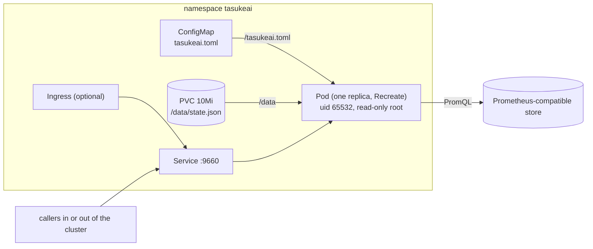

# Deployment

tasukeai is one static binary and one configuration file. It needs network access to the metrics store and to the
URLs of its HTTP checks, and nothing on the machines it decides about.

**Run one instance.** Leases are handed out under a lock inside the process. Two instances would each hand out the
same slot, so do not scale it out; if it restarts, `[state] path` brings the leases and holds back.

## Binary

Each [release](https://github.com/otaqq/tasukeai/releases) has static Linux binaries (musl, no dependencies) for
x86_64 and aarch64, with `SHA256SUMS`:

```sh
v=v0.9.1; t=x86_64-unknown-linux-musl          # or aarch64-unknown-linux-musl
curl -fsSLO https://github.com/otaqq/tasukeai/releases/download/$v/tasukeai-$v-$t.tar.gz
curl -fsSL https://github.com/otaqq/tasukeai/releases/download/$v/SHA256SUMS | sha256sum -c --ignore-missing
tar -xzf tasukeai-$v-$t.tar.gz && ./tasukeai-$v-$t/tasukeai --version
```

## systemd

For a machine without Docker or Kubernetes (a small board at the edge, a VM). The archive (from v0.5.1) and
[dist/systemd/tasukeai.service](../dist/systemd/tasukeai.service) have the unit:

```sh
sudo install -m 755 tasukeai-$v-$t/tasukeai /usr/local/bin/tasukeai
sudo install -d -m 755 /etc/tasukeai
sudo install -m 644 tasukeai.toml /etc/tasukeai/tasukeai.toml   # [state] path = "/var/lib/tasukeai/state.json"
sudo install -m 644 tasukeai-$v-$t/tasukeai.service /etc/systemd/system/tasukeai.service
sudo systemctl daemon-reload
sudo systemctl enable --now tasukeai
curl -s localhost:9660/health
journalctl -u tasukeai
```

| | |
|---|---|
| User | `DynamicUser=yes`: systemd makes a user for the service while it runs; no `useradd` |
| Configuration | `/etc/tasukeai/tasukeai.toml`, read-only to the service |
| State | `/var/lib/tasukeai` (`StateDirectory=`), the only place it can write; set `[state] path = "/var/lib/tasukeai/state.json"` |
| Listen | `0.0.0.0:9660`; change it with `sudo systemctl edit tasukeai` (a drop-in) |
| Limits | `MemoryMax=128M`; sandboxing (`ProtectSystem=strict`, no capabilities, `@system-service` system calls only), `systemd-analyze security tasukeai` rates it 1.2 OK |
| Stop | `SIGTERM`, it exits 0 |

The configuration is read on start: after a change, `sudo systemctl restart tasukeai`. To remove it:
`sudo systemctl disable --now tasukeai`, then delete the unit, the binary, `/etc/tasukeai` and
`/var/lib/private/tasukeai` (where `DynamicUser` keeps the state).

## Docker

```sh
cp examples/tasukeai.toml tasukeai.toml    # describe your machines and jobs
docker compose -f docker/compose.yaml up -d
curl -s localhost:9660/health
```

`docker/compose.yaml` runs the published image `ghcr.io/otaqq/tasukeai` (linux/amd64 and linux/arm64; a static
binary on distroless, as user 65532) at `TASUKEAI_VERSION` (default `latest`; `docker compose pull` updates it), mounts
`tasukeai.toml` read-only (`TASUKEAI_CONFIG` points elsewhere), publishes `TASUKEAI_PORT` (9660), restarts unless
stopped and checks health with `tasukeai health`. `up -d --build` builds the image from source (`docker/Dockerfile`)
instead. Without Compose:
`docker run -d -v $PWD/tasukeai.toml:/tasukeai.toml:ro -p 9660:9660 ghcr.io/otaqq/tasukeai`.

The image reads `/tasukeai.toml` and runs `serve`. With `[state] path = "/data/state.json"`, mount a writable
volume at `/data` owned by uid 65532.

## Kubernetes

The Helm chart in [charts/tasukeai](../charts/tasukeai) is published with each release (from v0.5.0) at
`oci://ghcr.io/otaqq/charts/tasukeai`, with the same version as the image. It works the same on k3s and other small
clusters at the edge.

```sh
cat > values.yaml <<'EOF'
config: |
  [state]
  path = "/data/state.json"

  [metrics]
  url = "http://prometheus-server.monitoring:80"

  [machines.desk]
  priority = 1
  accel = "cuda"
  presets = ["node"]
  rules = [{ signal = "up", min = 1 }]
  jobs = { train = 1 }

  [jobs.train]
  mode = "exclusive"
persistence:
  enabled: true
EOF
helm install tasukeai oci://ghcr.io/otaqq/charts/tasukeai --version 0.9.1 -n tasukeai --create-namespace -f values.yaml
```



What the chart does, and why:

- **One replica, `Recreate`.** There is no replica count: a second Pod would hand out the same slots (see above). On
  an update the old Pod stops before the new one starts, so the state file has one writer.
- **Configuration.** `config` holds the TOML and becomes a ConfigMap; `existingConfigMap` uses one you manage (key
  `tasukeai.toml`). The process reads it only on start, so a change of `config` restarts the Pod (a checksum
  annotation). With `existingConfigMap`, restart it yourself.
- **State.** `persistence.enabled` adds a PVC at `/data` (`10Mi`; the file is a few KiB). Set `[state] path =
  "/data/state.json"` in the configuration, or leases and holds stay in memory. The PVC is kept on `helm uninstall`
  (`helm.sh/resource-policy: keep`), so installing again brings the leases and holds back.
- **Security.** Non-root uid 65532, read-only root file system, no capabilities, RuntimeDefault seccomp, no service
  account token. Without `apiKey.existingSecret` the HTTP API has no authentication; enable the Ingress only for
  networks you trust.
- **API key.** `apiKey.existingSecret` names a Secret you create; its key `apiKey.secretKey` (default `api-key`)
  becomes `TASUKEAI_API_KEY`, and every route but `/health` needs it ([api.md](api.md)). Default: no key.
  `kubectl create secret generic tasukeai-api-key --from-literal=api-key="$(openssl rand -hex 32)"`.
- **Resources.** Requests `10m` CPU and `32Mi`, limit `128Mi` memory, far above the measured use (below).

Other values: `image`, `service`, `ingress`, `resources`, probes, `nodeSelector`, `tolerations`, `affinity`,
`priorityClassName`, `podAnnotations`, `podLabels` (see [values.yaml](../charts/tasukeai/values.yaml)).

Without Helm, the same objects as plain manifests: `helm template tasukeai charts/tasukeai -f values.yaml`.

## Footprint

tasukeai is small enough for edge devices. Measured on one instance in Kubernetes under light load, over 7 days
(cAdvisor metrics, x86_64):

| | now | peak (7 days) |
|---|---|---|
| RSS | 0.45 MiB | 0.52 MiB |
| Working set | 0.75 MiB | 1.24 MiB |
| CPU | about 0.012 cores | |

Under systemd, right after start with one machine (v0.5.0, x86_64): the service's cgroup uses 2.9 MiB
(`systemctl show -p MemoryCurrent`). The process RSS is 6.8 MiB, of which 4.3 MiB are pages of the binary itself
(`RssFile`, shared and dropped first under memory pressure) and 2.4 MiB its own memory (`RssAnon`).

The binary is static (musl), so it needs no libc or other files on the host. In v0.4.1 it is 6.6 MiB on x86_64
and 6.5 MiB on aarch64 (2.6 MiB as `.tar.gz`). Memory grows with the number of machines, jobs, leases and holds; the
numbers above are for a small setup, not a limit. Requests of `32Mi` memory and `10m` CPU, with a `128Mi` memory
limit, leave plenty of headroom.
