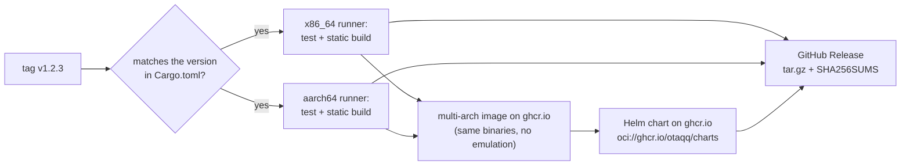

# Development

A Cargo workspace with two crates from one core:

| Crate | What |
|---|---|
| `crates/tasukeai-core` | the library: configuration, signal collection (PromQL, HTTP checks), rules, modes, reasons, leases |
| `crates/tasukeai` | the binary: HTTP API, CLI, the lease and hold store shared by its callers |

```sh
cargo fmt --all            # rustfmt.toml: max_width 120
cargo clippy --workspace --all-targets --locked -- -D warnings
cargo test --workspace --locked
cargo run -p tasukeai -- --config examples/tasukeai.toml check
cargo run -p tasukeai -- --config examples/tasukeai.toml signals        # what each machine reports now
cargo run -p tasukeai -- --config examples/tasukeai.toml assess train   # who can take it, and why not
```

## CI

CI runs the same three checks on every push to `main` and every pull request (`.github/workflows/ci.yml`), builds
the image and runs it once, and on GitHub repeats the tests and the image on native arm64. The Helm chart is linted
and rendered with every optional part on (`charts/tasukeai/ci/test-values.yaml`), the result validated with
kubeconform, and the chart's `version` and `appVersion` must match `Cargo.toml`: bump all three together.

`.github/workflows/security.yml` scans on pushes, pull requests and weekly: Trivy on the image and the repository
(vulnerabilities, misconfigurations, secrets; HIGH and CRITICAL with a fix) and `cargo audit` on `Cargo.lock`. On
GitHub the Trivy results go to code scanning; on other CI services one issue titled "Security scan: vulnerabilities
found" holds the report and is closed when a scan comes back clean.

## Release

A version tag (`v1.2.3`, or `v1.2.3-rc.1` for a pre-release) runs `.github/workflows/release.yml` on GitHub.



The binaries are built in the `builder` stage of `docker/Dockerfile`; the `release` stage puts them into the image,
with provenance and an SBOM (tags `1.2.3`, `1.2` and `latest`; a pre-release only its own version). The chart is
pushed after the image, so it never points at an image that is not there yet, and the GitHub Release comes last.
